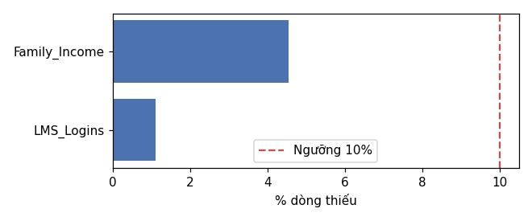
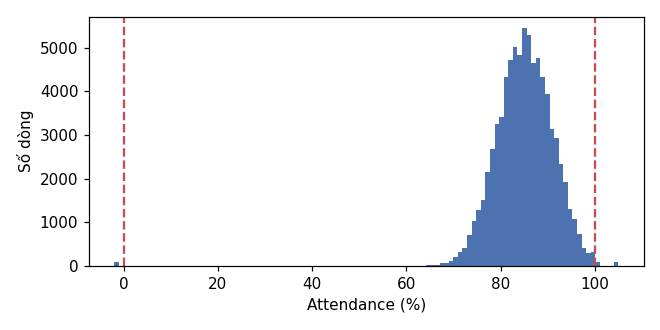
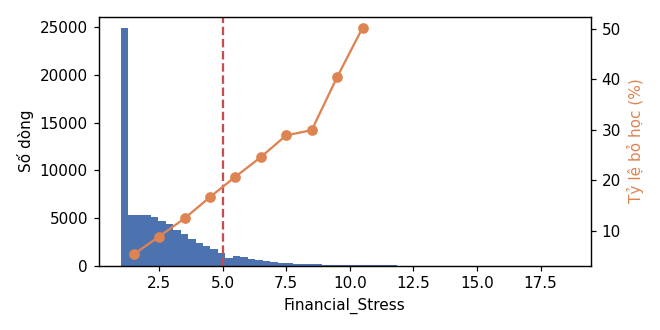
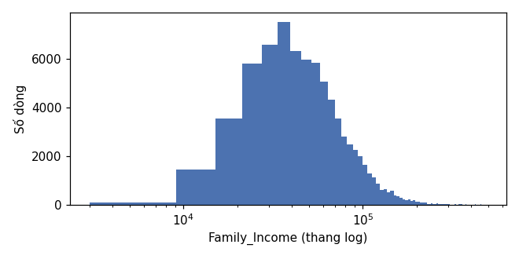

# BÁO CÁO CHẤT LƯỢNG DỮ LIỆU
*Sinh tự động bởi `python -m src.etl.validate` lúc 2026-10-26 19:17. Xem phương pháp tại `QUY_TRINH_DU_AN/GIAI_DOAN_B_KY_THUAT_DU_LIEU_ETL/B03_KIEM_TRA_CHAT_LUONG_DU_LIEU.md`.*

* **Nguồn:** `s3://raw/academic/ingest_date=2026-10-11/batch_id=20261011T085849Z_7df267/academic_survival_longitudinal.csv`
* **batch_id:** `20261011T085849Z_7df267`
* **MD5:** `94f87baf205fb7f1446639749a2dd852`
* **Kết luận data contract:** ⚠️ WARN (không có vi phạm chặn pipeline; các mục WARN đã có cách xử lý bên dưới)

## 1. Tóm tắt

| Kiểm tra | Trạng thái | Kết quả |
|---|:---:|---|
| Schema | ✅ OK | 79,239 dòng × 22 cột, đúng 22 cột theo src/core/schema.py |
| Trùng khóa (Uniqueness) | ✅ OK | Không có dòng trùng (Student_ID, Semester) |
| Giá trị thiếu (Completeness) | ⚠️ WARN | Family_Income: 3,604 (4.55%), LMS_Logins: 867 (1.09%) |
| Miền giá trị (Validity) | ⚠️ WARN | Attendance: 249 dòng (0.31%) |
| Thang đo Financial_Stress | ⚠️ WARN | 7,348 dòng > 5 (trung vị 2.1, P99 9.0, max 18.6). Tỷ lệ bỏ học tăng từ 5.3% (mức 1) lên 50.2% (mức ≥10), nên giá trị cao là tín hiệu thật: GIỮ NGUYÊN, không chặn về 5. |
| Giá trị phân loại (Consistency) | ⚠️ WARN | Gender có 8 cách ghi cho 3 nhóm chuẩn |
| Tính liên tục học kỳ | ✅ OK | 20,000 sinh viên, 100% có học kỳ liên tục từ kỳ 1 (trung bình 3.96 kỳ) |
| Cột tĩnh theo sinh viên | ✅ OK | 8 cột tĩnh không đổi trong cùng sinh viên |
| Logic nhãn & dữ liệu bị cắt | ⚠️ WARN | Target=1 ⇔ Dropped_Out trên 100% dòng (rò rỉ nhãn: loại End_of_Semester_Status, Censored khỏi đặc trưng). 11,115 dòng Censored=1 có nhãn chưa xác nhận → tập chấm điểm. Tập có nhãn: 68,124 dòng, lớp bỏ học 10.2%. |

> **OK**: sạch · **WARN**: vấn đề đã biết, xử lý ở bước sau · **ERROR**: vi phạm data contract, chặn pipeline.

## 2. Quyết định xử lý

| # | Vấn đề | Quyết định xử lý | Bước |
|:---:|---|---|:---:|
| 1 | `Family_Income` thiếu | Điền theo sinh viên (ffill + bfill, vì là thuộc tính tĩnh); còn trống thì cờ `Income_Missing`, trung vị trong Pipeline | B4, B10 |
| 2 | `LMS_Logins` thiếu | Forward-fill theo sinh viên (không bfill) + cờ `LMS_Missing`; còn trống thì trung vị trong Pipeline | B4, B10 |
| 3 | `Attendance` ngoài [0, 100] | Clip về [0, 100] (lỗi nhập liệu) | B4 |
| 4 | `Financial_Stress` vượt thang 1 – 5 | Giữ nguyên; winsorize P99 / `log1p` chỉ cho mô hình tuyến tính | B10 |
| 5 | `Family_Income` lệch phải | `log1p` cho mô hình tuyến tính | B10 |
| 6 | `Gender` nhiều cách ghi | Map về Female / Male / Other/Unknown theo `GENDER_MAP` | B4 |
| 7 | `Housing_Status` 3 giá trị | Giữ nguyên, One-Hot | B10 |
| 8 | Trùng khóa | `drop_duplicates(keep='last')` phòng ngừa | B4 |
| 9 | Rò rỉ nhãn | Loại `End_of_Semester_Status`, `Censored` khỏi đặc trưng | B9 |
| 10 | Nhãn bị cắt (`Censored = 1`) | Loại khỏi Train/Test, dùng làm tập chấm điểm | B9, B14 |

## 3. Chi tiết từng kiểm tra

### Giá trị thiếu (Completeness)

Family_Income: 3,604 (4.55%), LMS_Logins: 867 (1.09%)

|               |   so_dong_thieu |   ty_le_% | duoc_phep_thieu   |
|:--------------|----------------:|----------:|:------------------|
| Family_Income |            3604 |      4.55 | True              |
| LMS_Logins    |             867 |      1.09 | True              |

### Miền giá trị (Validity)

Attendance: 249 dòng (0.31%)

| cot                     | mien     |      min |       max |   duoi_min |   tren_max |   vi_pham |   ty_le_% |
|:------------------------|:---------|---------:|----------:|-----------:|-----------:|----------:|----------:|
| Age                     | [15, 60] |    17    |     37    |          0 |          0 |         0 |      0    |
| Family_Income           | [1, ∞]   |  3000    | 488000    |          0 |          0 |         0 |      0    |
| Household_Size          | [1, 15]  |     1    |      6    |          0 |          0 |         0 |      0    |
| Tuition_Base            | [1, ∞]   | 15000    |  45000    |          0 |          0 |         0 |      0    |
| Semester                | [1, 8]   |     1    |      8    |          0 |          0 |         0 |      0    |
| Course_Load             | [1, 30]  |     9    |     21    |          0 |          0 |         0 |      0    |
| Work_Hours              | [0, 80]  |     0    |     40    |          0 |          0 |         0 |      0    |
| Emergency_Expense       | [0, ∞]   |     0    |   3998    |          0 |          0 |         0 |      0    |
| Sem_GPA                 | [0, 4]   |     0.44 |      3.96 |          0 |          0 |         0 |      0    |
| Attendance              | [0, 100] |    -2    |    105    |         85 |        164 |       249 |      0.31 |
| LMS_Logins              | [0, ∞]   |    12    |    116    |          0 |          0 |         0 |      0    |
| Advising_Visits         | [0, ∞]   |     0    |      3    |          0 |          0 |         0 |      0    |
| Failed_Courses          | [0, ∞]   |     0    |      5    |          0 |          0 |         0 |      0    |
| Financial_Stress        | [1, ∞]   |     1    |     18.6  |          0 |          0 |         0 |      0    |
| First_Generation        | {0, 1}   |     0    |      1    |          0 |          0 |         0 |      0    |
| Scholarship             | {0, 1}   |     0    |      1    |          0 |          0 |         0 |      0    |
| Target_Dropout_Next_Sem | {0, 1}   |     0    |      1    |          0 |          0 |         0 |      0    |
| Censored                | {0, 1}   |     0    |      1    |          0 |          0 |         0 |      0    |

### Thang đo Financial_Stress

7,348 dòng > 5 (trung vị 2.1, P99 9.0, max 18.6). Tỷ lệ bỏ học tăng từ 5.3% (mức 1) lên 50.2% (mức ≥10), nên giá trị cao là tín hiệu thật: GIỮ NGUYÊN, không chặn về 5.

|     |   so_dong |   ty_le_bo_hoc |
|:----|----------:|---------------:|
| 1   |     31821 |            5.3 |
| 2   |     14001 |            8.9 |
| 3   |      9649 |           12.5 |
| 4   |      5714 |           16.7 |
| 5   |      3092 |           20.7 |
| 6   |      1678 |           24.6 |
| 7   |       926 |           28.9 |
| 8   |       491 |           29.9 |
| 9   |       304 |           40.5 |
| ≥10 |       448 |           50.2 |

### Giá trị phân loại (Consistency)

Gender có 8 cách ghi cho 3 nhóm chuẩn

|    | cot                    | gia_tri           |   so_dong | nhom_chuan    |
|---:|:-----------------------|:------------------|----------:|:--------------|
|  0 | Gender                 | Female            |     38035 | Female        |
|  1 | Gender                 | Male              |     36556 | Male          |
|  2 | Gender                 | Other             |      1125 | Other/Unknown |
|  3 | Gender                 | female            |       875 | Female        |
|  4 | Gender                 | male              |       764 | Male          |
|  5 | Gender                 | M                 |       739 | Male          |
|  6 | Gender                 | F                 |       716 | Female        |
|  7 | Gender                 | Prefer not to say |       429 | Other/Unknown |
|  8 | Housing_Status         | On-Campus         |     31315 | On-Campus     |
|  9 | Housing_Status         | With Parents      |     24767 | With Parents  |
| 10 | Housing_Status         | Off-Campus        |     23157 | Off-Campus    |
| 11 | End_of_Semester_Status | Enrolled          |     70354 | Enrolled      |
| 12 | End_of_Semester_Status | Dropped_Out       |      6917 | Dropped_Out   |
| 13 | End_of_Semester_Status | Graduated         |      1968 | Graduated     |

### Tính liên tục học kỳ

20,000 sinh viên, 100% có học kỳ liên tục từ kỳ 1 (trung bình 3.96 kỳ)

|   so_ky |   so_sinh_vien |
|--------:|---------------:|
|       1 |           3404 |
|       2 |           3365 |
|       3 |           2992 |
|       4 |           2534 |
|       5 |           2151 |
|       6 |           1812 |
|       7 |           1570 |
|       8 |           2172 |

### Cột tĩnh theo sinh viên

8 cột tĩnh không đổi trong cùng sinh viên

|                  |   so_sinh_vien_vi_pham |
|:-----------------|-----------------------:|
| Age              |                      0 |
| Gender           |                      0 |
| First_Generation |                      0 |
| Family_Income    |                      0 |
| Household_Size   |                      0 |
| Housing_Status   |                      0 |
| Scholarship      |                      0 |
| Tuition_Base     |                      0 |

### Logic nhãn & dữ liệu bị cắt

Target=1 ⇔ Dropped_Out trên 100% dòng (rò rỉ nhãn: loại End_of_Semester_Status, Censored khỏi đặc trưng). 11,115 dòng Censored=1 có nhãn chưa xác nhận → tập chấm điểm. Tập có nhãn: 68,124 dòng, lớp bỏ học 10.2%.

|                                                             |   so_dong | nhom                     |
|:------------------------------------------------------------|----------:|:-------------------------|
| Target=1 nhưng trạng thái khác Dropped_Out (hoặc ngược lại) |         0 | Vi phạm logic            |
| Kết cục (bỏ học / tốt nghiệp / bị cắt) không ở kỳ cuối      |         0 | Vi phạm logic            |
| Kỳ cuối không có kết cục                                    |         0 | Vi phạm logic            |
| Censored=1 nhưng trạng thái khác Enrolled                   |         0 | Vi phạm logic            |
| Censored (bị cắt)                                           |     11115 | Kết cục của sinh viên    |
| Dropped_Out                                                 |      6917 | Kết cục của sinh viên    |
| Graduated                                                   |      1968 | Kết cục của sinh viên    |
| Số dòng                                                     |     68124 | Tập có nhãn (Censored=0) |
| Số dòng bỏ học                                              |      6917 | Tập có nhãn (Censored=0) |

## 4. Biểu đồ

**Tỷ lệ thiếu theo cột (đường đỏ: ngưỡng data contract)**

**Attendance: 249 dòng nằm ngoài [0, 100] (đường đỏ) → clip ở B4**

**Financial_Stress: phân phối (cột) và tỷ lệ bỏ học theo mức (đường cam); vạch đỏ là mốc 5 của thang mô tả**

**Family_Income lệch phải mạnh (3,000 → 488,000) → log1p cho mô hình tuyến tính**

