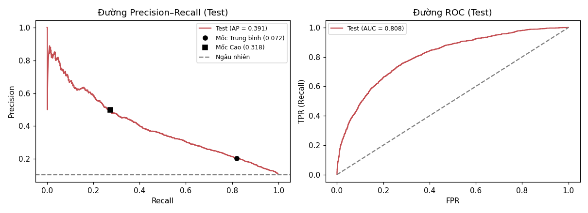
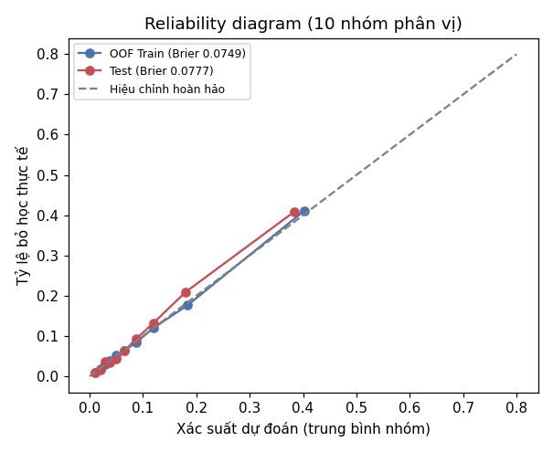
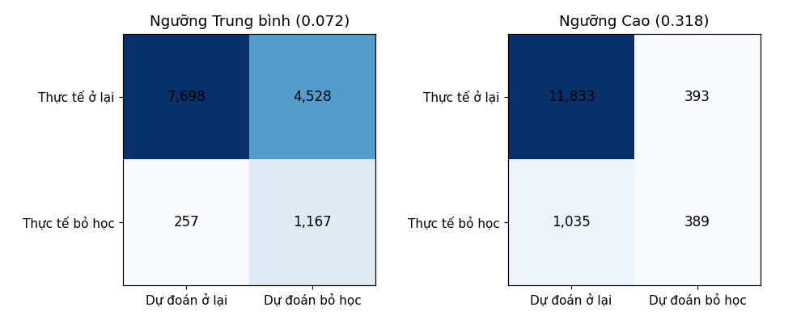
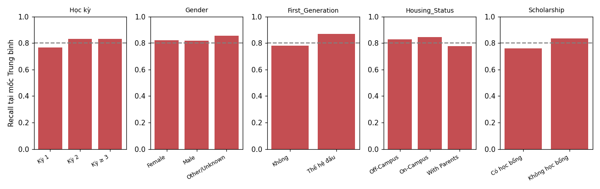

# BÁO CÁO ĐÁNH GIÁ MÔ HÌNH (B12)
*Sinh tự động bởi `python -m src.ml.evaluate` lúc 2026-10-26 22:37. Mọi lựa chọn chốt trên Train trước khi nhìn Test; đây là lần đánh giá Test thứ **2**.*

> **Lần đánh giá Test trước** (2026-10-26 21:41, PR-AUC 0.4002) bị thay thế. Lý do đánh giá lại: B13 (SHAP) phát hiện rò rỉ: cờ Income_Missing cũ = 'không khai báo thu nhập ở kỳ nào' (ffill + bfill) nhìn trước tương lai (84,7% bỏ học so với 10,7% khi tính đúng thời điểm). Đã sửa B4 (chỉ ffill), chạy lại B5 → B11; cấu hình mô hình (LogReg, chính sách ngưỡng) không đổi và được chốt trên Train trước khi đánh giá lại.

* **Mô hình:** Logistic Regression, `C = 0.011`, không trọng số lớp, 43 đặc trưng.
* **Train:** 54,474 dòng · **Test:** 13,650 dòng (3,604 sinh viên), tỷ lệ bỏ học 10.4%.
* **Mốc rủi ro** (chọn trên OOF Train): Trung bình ≥ **0.0717** (Recall OOF ≥ 0,80) · Cao ≥ **0.3175** (Precision OOF ≥ 0,50).

## 1. Kết quả tổng thể

| Chỉ số | OOF Train (để chọn) | **Test** |
|---|---:|---:|
| PR-AUC | 0.3973 | **0.3914** |
| ROC-AUC | 0.8004 | **0.8079** |
| Brier score | 0.0749 | **0.0777** |
| Xác suất TB / tỷ lệ thật | 0.1009 / 0.1008 | 0.0985 / 0.1043 |
| Recall @ Trung bình | 0.800 | **0.820** |
| Precision @ Trung bình | 0.193 | **0.205** |
| % dòng ≥ Trung bình | 41.7% | 41.7% |
| Recall @ Cao | 0.309 | **0.273** |
| Precision @ Cao | 0.500 | **0.497** |
| % dòng ở mức Cao | 6.2% | 5.7% |

## 2. Ba mức rủi ro trên Test

| Mức | Số dòng | % dòng | Tỷ lệ bỏ học thực tế | % ca bỏ học thuộc mức này |
|---|---:|---:|---:|---:|
| Thấp | 7,955 | 58.3% | 3.2% | 18.0% |
| Trung bình | 4,913 | 36.0% | 15.8% | 54.6% |
| Cao | 782 | 5.7% | 49.7% | 27.3% |

## 3. Công bằng theo nhóm (Test, tại mốc Trung bình)

| chieu            | nhom           |   so_dong |   ty_le_bo_hoc |   recall |   precision |   pr_auc |
|:-----------------|:---------------|----------:|---------------:|---------:|------------:|---------:|
| Học kỳ           | Kỳ 1           |      3604 |          0.071 |    0.766 |       0.179 |    0.346 |
| Học kỳ           | Kỳ 2           |      2974 |          0.116 |    0.831 |       0.241 |    0.43  |
| Học kỳ           | Kỳ ≥ 3         |      7072 |          0.117 |    0.831 |       0.201 |    0.392 |
| Gender           | Female         |      6819 |          0.106 |    0.82  |       0.205 |    0.393 |
| Gender           | Male           |      6574 |          0.101 |    0.817 |       0.203 |    0.387 |
| Gender           | Other/Unknown  |       257 |          0.136 |    0.857 |       0.238 |    0.474 |
| First_Generation | Không          |      9020 |          0.088 |    0.78  |       0.198 |    0.373 |
| First_Generation | Thế hệ đầu     |      4630 |          0.136 |    0.87  |       0.214 |    0.415 |
| Housing_Status   | Off-Campus     |      4010 |          0.107 |    0.829 |       0.205 |    0.381 |
| Housing_Status   | On-Campus      |      5283 |          0.108 |    0.844 |       0.207 |    0.407 |
| Housing_Status   | With Parents   |      4357 |          0.098 |    0.776 |       0.202 |    0.387 |
| Scholarship      | Có học bổng    |      3941 |          0.072 |    0.759 |       0.175 |    0.322 |
| Scholarship      | Không học bổng |      9709 |          0.118 |    0.835 |       0.213 |    0.412 |

## 4. Ca bỏ sót (bỏ học nhưng dưới mốc Trung bình) so với ca bắt được

|                  |   bo_sot_FN |   bat_duoc_TP |    o_lai |
|:-----------------|------------:|--------------:|---------:|
| Sem_GPA          |        2.8  |          2.27 |     2.74 |
| Failed_Courses   |        0.39 |          1.36 |     0.6  |
| Financial_Stress |        2.09 |          4.2  |     2.44 |
| Work_Hours       |       15.37 |         22.98 |    16.46 |
| Attendance       |       85.52 |         82.68 |    85.51 |
| Semester         |        3.02 |          3.37 |     3.03 |
| Family_Income    |    69192.2  |      44582.5  | 63117.5  |

## 5. Đối chứng phụ trên Test (KHÔNG dùng để chọn mô hình; mô hình đã chốt trước)

| Mô hình | PR-AUC Test |
|---|---:|
| LogReg – 43 đặc trưng (mô hình được chọn) | 0.3914 |
| LogReg – chỉ 20 đặc trưng gốc (ablation) | 0.3874 |
| XGBoost tinh chỉnh (dự phòng) | 0.3950 |

## 6. Biểu đồ

**Đường PR và ROC trên tập Test, kèm 2 mốc rủi ro**

**Độ hiệu chỉnh xác suất: OOF trên Train và Test**

**Ma trận nhầm lẫn trên Test tại 2 mốc**

**Recall theo nhóm trên Test (đường xám: mục tiêu 0,80)**

