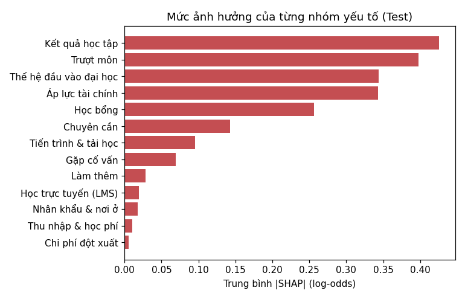
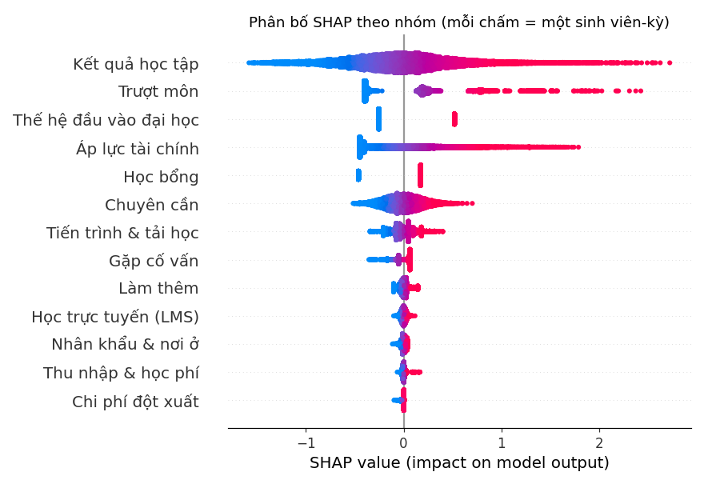
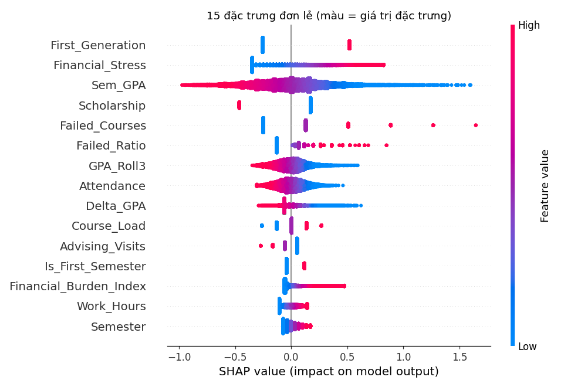
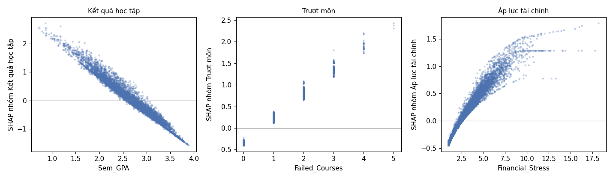
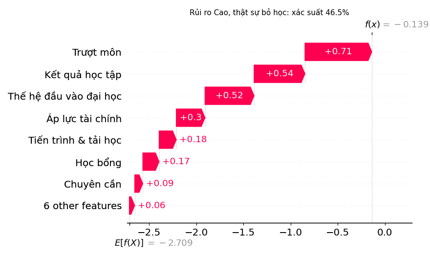
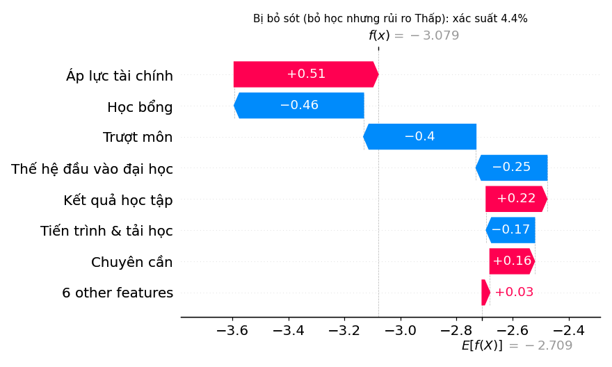
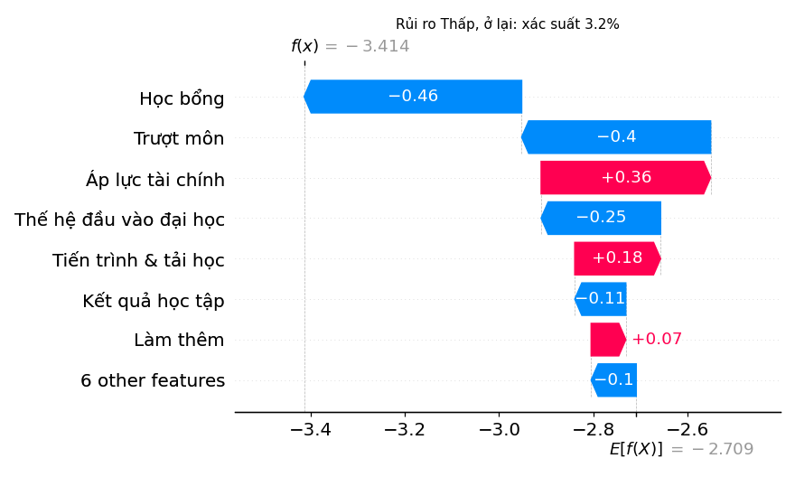

# GIẢI THÍCH MÔ HÌNH BẰNG SHAP (B13)
*Sinh tự động bởi `python -m src.ml.explain` lúc 2026-10-26 22:40. SHAP chính xác cho Logistic Regression (`LinearExplainer`), thang log-odds, nền = trung bình Train. Giải thích trên 13,650 dòng Test.*

* Giá trị cơ sở φ₀ = -2.709 (log-odds) ↔ xác suất 6.2% cho "sinh viên trung bình".
* Kiểm tra tính cộng φ₀ + Σφ = log-odds của mô hình: sai số lớn nhất 1.8e-15.

## 1. Nhóm yếu tố quan trọng nhất (toàn cục)

| Nhóm | Trung bình \|SHAP\| | % tổng | Là lý do số 1 ở mức Cao | Có đưa ra làm lý do |
|---|---:|---:|---:|:---:|
| Kết quả học tập | 0.426 | 19.8% | 47.1% | ✓ |
| Trượt môn | 0.397 | 18.4% | 31.5% | ✓ |
| Thế hệ đầu vào đại học | 0.344 | 16.0% | 0.5% | ✓ |
| Áp lực tài chính | 0.343 | 15.9% | 20.8% | ✓ |
| Học bổng | 0.256 | 11.9% | 0.0% | ✓ |
| Chuyên cần | 0.143 | 6.6% | 0.1% | ✓ |
| Tiến trình & tải học | 0.096 | 4.4% | 0.0% | ✓ |
| Gặp cố vấn | 0.070 | 3.2% | 0.0% |  |
| Làm thêm | 0.028 | 1.3% | 0.0% | ✓ |
| Học trực tuyến (LMS) | 0.019 | 0.9% | 0.0% | ✓ |
| Nhân khẩu & nơi ở | 0.018 | 0.8% | 0.0% |  |
| Thu nhập & học phí | 0.011 | 0.5% | 0.0% | ✓ |
| Chi phí đột xuất | 0.006 | 0.3% | 0.0% | ✓ |

Nhân khẩu & nơi ở và Gặp cố vấn vẫn được tính vào điểm rủi ro nhưng không được nêu làm lý do cảnh báo (không can thiệp được / nhân quả ngược).

## 2. Đặc trưng đơn lẻ (15 lớn nhất) và dấu hệ số

| Đặc trưng | Nhóm | Trung bình \|SHAP\| | Hệ số (sau chuẩn hóa) |
|---|---|---:|---:|
| First_Generation | Thế hệ đầu vào đại học | 0.344 | +0.77 |
| Financial_Stress | Áp lực tài chính | 0.265 | +0.31 |
| Sem_GPA | Kết quả học tập | 0.264 | -0.35 |
| Scholarship | Học bổng | 0.256 | -0.63 |
| Failed_Courses | Trượt môn | 0.255 | +0.30 |
| Failed_Ratio | Trượt môn | 0.132 | +0.15 |
| GPA_Roll3 | Kết quả học tập | 0.100 | -0.13 |
| Attendance | Chuyên cần | 0.095 | -0.12 |
| Delta_GPA | Kết quả học tập | 0.079 | -0.10 |
| Course_Load | Tiến trình & tải học | 0.071 | +0.10 |
| Advising_Visits | Gặp cố vấn | 0.063 | -0.07 |
| Is_First_Semester | Tiến trình & tải học | 0.062 | +0.16 |
| Financial_Burden_Index | Áp lực tài chính | 0.062 | +0.09 |
| Work_Hours | Làm thêm | 0.056 | +0.07 |
| Semester | Tiến trình & tải học | 0.055 | +0.07 |

Biến cùng nhóm tương quan mạnh (ví dụ `Sem_GPA`, `CGPA`, `GPA_Roll3`, ρ ≈ 0,97) nên LogReg chia hệ số giữa chúng, có biến mang dấu ngược với biến chính của nhóm:

* `Tuition_Base` (+0.023) ngược dấu với `Tuition_to_Income` (-0.027), tương quan +0.51
* `Work_Hours` (+0.066) ngược dấu với `Work_prev` (-0.073), tương quan +0.87

Đọc riêng các biến này sẽ ra lý do vô lý, vì vậy lý do cảnh báo được tổng hợp theo **nhóm**, không theo từng biến.

## 3. Kiểm tra rò rỉ

| Kiểm tra | Kết quả | Chi tiết |
|---|:---:|---|
| Không biến nào chiếm > 30% tổng |SHAP| | ✅ | lớn nhất: First_Generation 13.0% |
| Income_Missing (hiếm, 1.47% dòng) không đẩy log-odds > 2 | ✅ | SHAP trung bình khi = 1: +0.11 |
| LMS_Missing (hiếm, 1.06% dòng) không đẩy log-odds > 2 | ✅ | SHAP trung bình khi = 1: -0.01 |
| Cột rò rỉ End_of_Semester_Status không nằm trong mô hình | ✅ |  |
| Cột rò rỉ Censored không nằm trong mô hình | ✅ |  |

## 4. Ví dụ giải thích cho từng sinh viên (`top_reasons`)

**Rủi ro Cao, thật sự bỏ học** – xác suất 46.5%, mức Cao

1. **Trượt môn** (+0.71): Trượt 2 môn kỳ này, tích lũy 2 môn
2. **Kết quả học tập** (+0.54): GPA kỳ này 2,22, GPA tích lũy 2,22
3. **Thế hệ đầu vào đại học** (+0.52): Thế hệ đầu tiên trong gia đình vào đại học

**Bị bỏ sót (bỏ học nhưng rủi ro Thấp)** – xác suất 4.4%, mức Thấp

1. **Áp lực tài chính** (+0.51): Chỉ số áp lực tài chính 4,2 (tăng 0,7 so với kỳ trước)
2. **Kết quả học tập** (+0.22): GPA kỳ này 2,55 (giảm 0,16 so với kỳ trước), GPA tích lũy 2,70
3. **Chuyên cần** (+0.16): Chuyên cần 80% (giảm 4 điểm so với kỳ trước)

**Rủi ro Thấp, ở lại** – xác suất 3.2%, mức Thấp

1. **Áp lực tài chính** (+0.36): Chỉ số áp lực tài chính 3,9
2. **Tiến trình & tải học** (+0.18): Học kỳ 1, 18 tín chỉ
3. **Làm thêm** (+0.07): Làm thêm 28 giờ/tuần

## 5. Biểu đồ

**Tầm quan trọng toàn cục theo nhóm khái niệm (trung bình |SHAP| trên Test)**

**Beeswarm theo nhóm: vị trí ngang là tác động lên log-odds của từng dòng Test**

**Beeswarm 15 đặc trưng đơn lẻ (màu = giá trị đặc trưng; đỏ cao, xanh thấp)**

**SHAP của nhóm theo biến đại diện (độ tản dọc = phần đóng góp của các biến khác cùng nhóm)**

**Waterfall (log-odds) – Rủi ro Cao, thật sự bỏ học**

**Waterfall (log-odds) – Bị bỏ sót (bỏ học nhưng rủi ro Thấp)**

**Waterfall (log-odds) – Rủi ro Thấp, ở lại**

